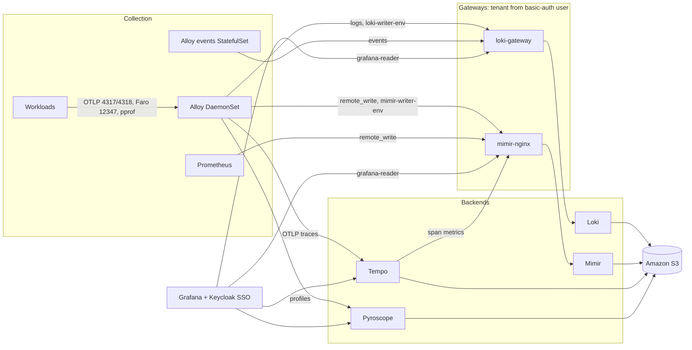

<div align="center"> 
  <h1>🚀 LGTM stack on Kubernetes Complete Hands‑On Guides 🌟 </h1>
  <a href="https://github.com/kioskOG/observability-hub"> </a>  
  <br>
    
  
  
  
  
  
  

  <!--  -->
  <a href="https://github.com/kioskOG/observability-hub/blob/main/LICENSE">  </a>
  <a href="https://github.com/kioskOG/observability-hub/graphs/contributors">  </a>
  <a href="https://github.com/kioskOG/observability-hub/issues">   </a>
  <a href="https://github.com/kioskOG/observability-hub/pulls">  </a>
  <a href="https://github.com/kioskOG/observability-hub/pulls">  </a>
  </div>

---

# Observability Hub

Helm values, Kubernetes manifests, Terragrunt stacks and a **Makefile** to run a Grafana LGTM observability stack on **AWS EKS**:

- **Loki**: logs
- **Mimir**: metrics
- **Tempo**: traces
- **Pyroscope**: continuous profiling
- **Grafana Alloy**: collection of logs, metrics, OTLP traces, profiles and Faro RUM
- **kube-prometheus-stack**: Prometheus Operator, Prometheus, Grafana with Keycloak SSO, Alertmanager
- **Blackbox Exporter** and **Grafana Beyla**

What the repository gives you:
- **Repeatable installs:** Terragrunt for AWS, the Makefile for Helm.
- **Storage:** S3 behind Loki, Mimir, Tempo and Pyroscope, accessed through IRSA.
- **Secrets:** stored in **AWS Secrets Manager** and synced by the **External Secrets Operator**.
- **Multi-tenancy:** Loki and Mimir use **one tenant per environment** (`prod`, `stage`, `dev`). The nginx gateways derive the tenant from the basic-auth user and never trust the client.

**Contents:**
- [Architecture](#architecture)
- [Repository layout](#repository-layout)
- [Prerequisites](#prerequisites)
- [Complete installation (from scratch)](#complete-installation-from-scratch)
- [Environments (prod / stage / dev)](#environments-prod--stage--dev)
- [Multi-tenancy (Loki and Mimir)](#multi-tenancy-loki-and-mimir)
- [Day-2 management](#day-2-management)
- [Charts and versions](#charts-and-versions)
- [Secrets and credentials](#secrets-and-credentials)
- [Makefile reference](#makefile-reference)
- [Components](#components)
- [Troubleshooting](#troubleshooting)
- [Further documentation](#further-documentation)

---

## Architecture



All observability workloads run on a dedicated EKS node group. It is labelled `workload=observability` and tainted `dedicated=observability:NoSchedule`. See [`Docs/Prod-Rollout.md`](Docs/Prod-Rollout.md).

---

## Repository layout

| Path | Purpose |
|------|---------|
| `helm/Chart.yaml`, `helm/Chart.lock` | Every Helm chart the stack runs, with its pinned version (manifest only, not installable). Archives are downloaded to `helm/charts/` (git-ignored) |
| `Makefile` | Terragrunt AWS targets, ESO, Helm installs, port-forwards, teardown. Resolves `CLUSTER_NAME` and `REGION` from env, then kubectl, then aws (`scripts/resolve-cluster-env.sh`) |
| `terragrunt/infrastructure-modules/` | Terraform modules: vpc, eks, iam, s3, secrets, keycloak-client, route53, … |
| `terragrunt/infrastructure-live/accounts/mlops/` | Live stacks: VPC, EKS, S3 buckets, IRSA roles, Keycloak Grafana client, Grafana OAuth secret. Also holds `render-observability-helm-and-state.sh` |
| `loki/` | `loki-values-template.yaml`: Loki, gateway tenant enforcement, canary, ruler |
| `mimir/` | `mimir-values-template.yaml`: Mimir, `mimir-nginx` tenant enforcement. Also rules, alerts and dashboards |
| `tempo/` | `tempo-values-template.yaml` and a trace demo app |
| `pyroscope/` | `pyroscope-values-template.yaml` and sample apps |
| `alloy/` | Helm overrides `alloy-override-values.yaml` (DaemonSet: logs, OTLP, profiles, Faro) and `alloy-events-values.yaml` (single-replica Kubernetes events). The Alloy configs are in `alloy/config/daemonset.alloy` and `alloy/config/events.alloy` |
| `kube-prometheus-stack/` | `prometheus-values.yaml` (overrides for the upstream chart) and `prometheus-values-template.yaml` (Grafana SSO, rendered) |
| `external-secrets/` | ClusterSecretStore, ExternalSecrets, and `seed-aws-secrets.sh` |
| `beyla/`, `blackbox-exporter/`, `faro/` | eBPF auto-instrumentation, probes, Faro Web SDK example |
| Demo apps | `tempo/tracing-demo-app/`, `pyroscope/pyroscope-app/`, `pyroscope/pyroscope-rideshare-go/`, `short-url-application/`, `trace-generator.yaml` (k6 OTLP trace generator) |
| `default-storage-class.yaml` | EBS `gp2-standard` StorageClass used by the charts |

Every chart comes from its upstream Helm repo and is pinned in one place: [`helm/Chart.yaml`](helm/Chart.yaml), with the resolved set recorded in `helm/Chart.lock` (see [Charts and versions](#charts-and-versions)). Values files hold only the settings that differ from the chart defaults; `helm show values helm/charts/<chart>-<version>.tgz` shows the rest.

---

## Prerequisites

**Local tools:** `kubectl`, `helm` 3, `aws` CLI v2, `terragrunt` and `terraform`, `jq`, `envsubst` (gettext), `openssl`, and `htpasswd` (apache2-utils / httpd-tools).

**AWS:**
- An account and credentials that can manage VPC, EKS, IAM, S3 and Secrets Manager.
- EKS with an **OIDC provider** (for IRSA) and the **EBS CSI** add-on. Both are created by the `eks` stack.
- Observability nodes sized for the stack (≈ 18 vCPU / 53 GiB requested). The `eks` stack creates 6 × m6i.2xlarge, 2 per AZ across `us-east-2a/b/c`: node group `observability` (a + b) and `observability-c`.

**Keycloak:** a reachable instance, with admin credentials for the Terraform `keycloak-client` module. Grafana SSO uses it, and `render-helm-values` currently reads the Grafana client's outputs, so it is needed for every install.

---

## Complete installation (from scratch)

Run everything from the repository root unless a step says `cd`. The paths assume the `mlops` account and `us-east-2`; adjust them for yours.

### 0. Set the target

```bash
export CLUSTER_NAME=millenniumfalcon
export AWS_REGION=us-east-2
export ENVIRONMENT=dev          # prod | stage | dev, the Loki/Mimir tenant of this cluster
```

Before installing, set the same environment in the values files. See [Environments](#environments-prod--stage--dev).

### 1. Network and EKS

```bash
cd terragrunt/infrastructure-live/accounts/mlops/us-east-2/vpc && terragrunt apply
cd ../eks && terragrunt apply
cd -   # back to repo root

aws eks update-kubeconfig --region "$AWS_REGION" --name "$CLUSTER_NAME"
make show-env                                  # CLUSTER_NAME / REGION as Make sees them
kubectl get nodes -l workload=observability -L topology.kubernetes.io/zone   # 6 Ready, 2 per AZ
```

### 2. Keycloak client for Grafana SSO

```bash
cd terragrunt/infrastructure-live/accounts/mlops/us-east-2/keycloak/grafana && terragrunt apply
cd ../../secrets/grafana-auth && terragrunt apply     # OAuth client secret → Secrets Manager
cd -
```

`render-helm-values` reads this stack's outputs (client ID and OIDC endpoints), so apply it before step 3. See [`Docs/Grafana-SSO-Production.md`](Docs/Grafana-SSO-Production.md); turning SSO off afterwards is covered there too.

### 3. S3 buckets and IRSA roles

```bash
make aws-plan     # review: six S3 stacks + global/iam/role
make aws-apply    # S3 → IAM roles → renders the Helm override values
```

`make aws-apply` ends with `make render-helm-values`. That writes `*-override-values.rendered.yaml` (git-ignored) from the templates, using Terragrunt outputs for bucket names, IRSA role ARNs and the Keycloak endpoints. Re-run `make render-helm-values` whenever a template or one of those outputs changes.

### 4. External Secrets Operator

```bash
make external-secrets    # ESO Helm install with its IRSA role from Terragrunt; waits for CRDs + webhook
```

### 5. Seed credentials in Secrets Manager

```bash
make eso-seed ENVIRONMENT=$ENVIRONMENT
```

This creates every gateway user with a random password. The users are `loki-writer-{prod,stage,dev}`, `mimir-writer-{prod,stage,dev}`, `loki-canary`, `loki-ruler` and `grafana-reader`. It writes the htpasswd files and the client credentials (see [Secrets](#secrets-and-credentials)), and gives Alloy, Prometheus and Tempo the writers for `ENVIRONMENT`. Passwords are printed once and never written to disk. **Re-running the script rotates every password.**

### 6. Install the stack

```bash
make install
```

`make install` runs `render-helm-values` and `init`, then installs the components in this order:

| # | Target | Notes |
|---|--------|-------|
| 0 | `render-helm-values` | Re-renders the templates from current Terragrunt outputs |
| 1 | `init` | `make charts` (locked chart archives), StorageClass, namespaces, then `eso-apply`: ClusterSecretStore and all ExternalSecrets, waiting until they're Ready |
| 2 | `install-kube-prometheus-stack` | Prometheus, Grafana (with the rendered SSO overrides), Alertmanager. `--set clusterName=$CLUSTER_NAME` |
| 3 | `install-mimir` | Takes several minutes (`--timeout 15m`) |
| 4 | `install-loki` | |
| 5 | `install-tempo` | |
| 6 | `install-alloy` | DaemonSet |
| 7 | `install-alloy-events` | Single-replica events collector |
| 8 | `install-pyroscope` | |
| 9 | `install-blackbox` | |
| 10 | `install-beyla` | |

Any single component can be (re)installed with its `make install-<component>` target. For Loki, Mimir, Tempo, Pyroscope and kube-prometheus-stack, the target re-renders the values first if their template changed. Add `DEBUG=1` to any helm target for `--debug` output.

### 7. Verify

```bash
make status                                         # all pods Running
make eso-check-store                                # every ExternalSecret SecretSynced
kubectl -n loki exec deploy/loki-gateway -- nginx -t
kubectl -n mimir exec deploy/mimir-nginx -- nginx -t
kubectl -n alloy-logs logs ds/grafana-alloy --tail=200 | grep -E ' 40[13] ' || echo "no auth errors"
```

Then open Grafana (`make pf-grafana` → http://localhost:3000, or your ingress). Sign in with Keycloak, or as the local admin `admin` with the password from Secrets Manager `observability-hub/grafana-admin`. There is no anonymous access.

On an install that existed before the admin password moved to Secrets Manager, run `make grafana-admin-reset` once; until then the old `prom-operator` password stays valid.

| Check | Where | Expect |
|-------|-------|--------|
| Logs arrive | Explore → **Loki** → `{source="pod"}` | Pod logs of this environment |
| Events arrive | **Loki** → `{source="k8s-events"}` | Kubernetes events |
| Metrics arrive | Explore → **Mimir** → `up` | Series with `cluster="$CLUSTER_NAME"` |
| Traces | Explore → **Tempo** → Search | Traces (after generating traffic) |
| Trace → logs | Open a span → **Logs for this span** | Span logs (`job="spanlogs"`) |
| Profiles | Explore → **Pyroscope** | CPU profiles (eBPF) |

---

## Environments (prod / stage / dev)

One cluster ships one environment, and the environment name is also the Loki and Mimir tenant. When you create per-environment values files, these values must agree:

| Setting | File | dev example |
|---------|------|-------------|
| `ENVIRONMENT_NAME` (Alloy `extraEnv`) | `alloy/alloy-override-values.yaml` | `dev` |
| `ENVIRONMENT_NAME` (Alloy `extraEnv`) | `alloy/alloy-events-values.yaml` | `dev` |
| `grafana.env.TENANT` | `kube-prometheus-stack/prometheus-values.yaml` | `dev` |
| `ENVIRONMENT` for `make eso-seed` | command line | `dev` |
| `KUBE_CLUSTER_NAME` (Alloy) | both Alloy files | `millenniumfalcon` (= `CLUSTER_NAME`) |
| `AWS_REGION` (Alloy) | both Alloy files | `us-east-2` (= `REGION`) |

If they disagree, writes fail loudly: the gateway answers **403** when Alloy's `tenant_id` differs from its writer user's environment. A mismatched Grafana `TENANT` shows up as "no data" instead.

`alloy.extraEnv` is a list, and Helm replaces lists rather than merging them. A per-environment Alloy values file must therefore carry the **whole** `extraEnv` list, not only `ENVIRONMENT_NAME`. Add the extra file through the Makefile's values list, for example `make install-alloy VALUES_alloy="./alloy/alloy-override-values.yaml ./alloy/values-prod.yaml"`. The same works for `VALUES_alloy-events` and `VALUES_kube-prometheus-stack`.

Several environments can share one hub (one Loki/Mimir) or each run their own. If they share an AWS account but use separate hubs, give each its own `ESO_SECRET_PREFIX`, because `eso-seed` writes `alloy-remote-credentials` and `mimir-remote-write` for one environment at a time.

---

## Multi-tenancy (Loki and Mimir)

### One tenant per environment

The tenant (`X-Scope-OrgID`) is the **environment**: `prod`, `stage` or `dev`. Every log stream Alloy ships goes to its environment's tenant, and so does every metric written by Alloy, Prometheus and Tempo. Inside a tenant, streams are told apart by **labels**:

| Log source | `source` label | Other useful labels |
|------------|----------------|---------------------|
| Pod container logs | `pod` | `namespace`, `pod`, `container`, `app` |
| Kubernetes events (`alloy-events-values.yaml`) | `k8s-events` | `k8s_namespace_name` (`cluster` for cluster-scoped objects), `k8s_event_reason`, `k8s_event_type` |
| Node syslog | `syslog` | `job="node/syslog"` |
| Node journal | `journal` | `unit`, `service_name` |
| Alloy internal logging | `alloy` | |
| OTLP span logs | `otelcol.connector.spanlogs` | `job="spanlogs"`, `service_name` |
| Faro (RUM) | `faro` | `job="faro/rum"` |

Alloy sets the tenant once, on `loki.write` → `tenant_id = sys.env("ENVIRONMENT_NAME")`.

### Loki gateway enforcement

Configured in `loki/loki-values-template.yaml` → `gateway.nginxConfig.httpSnippet` / `serverSnippet`.

| Gateway user | Tenant | Used by |
|--------------|--------|---------|
| `loki-writer-<env>` | `<env>` | Alloy in that environment (`alloy-remote-credentials`) |
| `grafana-reader` | Client header, only env tenants (`dev`, or `prod\|stage\|dev`) | Grafana datasources |
| `loki-canary` | `canary` | Loki canary |
| anyone else | none → Loki 401 | |

Some chart locations (queries, tail) set their own proxy headers, so they don't inherit the http-level tenant header. A server-level check therefore returns **403** whenever the client's `X-Scope-OrgID` differs from the tenant allowed for its user.

### Mimir gateway enforcement

Mimir runs with `multitenancy_enabled: true` and `tenant_federation.enabled: true`. The tenant rules live in `mimir/mimir-values-template.yaml` → `nginx.nginxConfig.file`. The chart reads `nginx.nginxConfig`; the old `nginx.config` key was silently ignored.

`mimir-nginx` always **replaces** `X-Scope-OrgID` with the tenant allowed for the user:

| Gateway user | Tenant | Used by |
|--------------|--------|---------|
| `mimir-writer-<env>` | `<env>` | Alloy, Prometheus, Tempo metrics-generator of that environment |
| `loki-ruler` | Client header if it is one env tenant | Loki ruler, which sends the rule's Loki tenant |
| `grafana-reader` | Env tenants, `prod\|stage\|dev`, or `anonymous` | Grafana datasources |
| anyone else | none → Mimir 401 | |

`anonymous` holds metrics written before multitenancy was enabled. Moving to tenancy on an existing install is described in [`Docs/Multi-Tenancy.md`](Docs/Multi-Tenancy.md).

### Grafana datasources

| Datasource | uid | `X-Scope-OrgID` |
|------------|-----|-----------------|
| **Loki** | `loki` | `$__env{TENANT}` |
| **Loki (all environments)** | `loki-all` | `prod\|stage\|dev` (results carry `__tenant_id__`) |
| **Mimir** | `mimir` | `$__env{TENANT}` |
| **Mimir (all environments)** | `mimir-all` | `prod\|stage\|dev` (series carry `__tenant_id__`) |
| **Mimir (pre-tenancy history)** | `mimir-anonymous` | `anonymous` |
| **Tempo** | `tempo` | none (Tempo is single-tenant). Trace → logs uses `loki` |
| **Pyroscope** | `pyroscope` | none |

Example queries: `{source="pod", namespace="payments"}`, `{source="k8s-events", k8s_event_type="Warning"}`, `{job="spanlogs"} | trace_id="<id>"`.

---

## Day-2 management

### Change configuration and upgrade a component

1. Edit the values, or the Alloy config in `alloy/config/*.alloy`.
   - Templates (`*-values-template.yaml`) are the source for Loki, Mimir, Tempo, Pyroscope and the Grafana SSO overrides. `make install-<component>` re-renders them when they change.
   - The Alloy, Beyla, Blackbox and `prometheus-values.yaml` files are used as they are.
   - Keep the values files as overrides only; check a chart default with `helm show values <chart> --version <VERSION>`.
2. If Terragrunt outputs changed (buckets, IRSA roles, Keycloak): `make render-helm-values`.
3. Check the render: `make template-debug-<component>`.
4. Apply it: `make install-<component>` (a `helm upgrade --install`).

To bump a chart, see [Charts and versions](#charts-and-versions).

### Rotate credentials

```bash
make eso-seed ENVIRONMENT=$ENVIRONMENT    # new random passwords for every gateway user
make eso-apply                            # re-sync now (otherwise ESO refreshes hourly); restarts Grafana
kubectl -n alloy-logs rollout restart ds/grafana-alloy sts/grafana-alloy-events
kubectl -n monitoring rollout restart sts/prometheus-kube-prometheus-stack-prometheus
kubectl -n tempo rollout restart deploy/tempo-metrics-generator
kubectl -n loki rollout restart ds/loki-canary sts/loki-ruler
make grafana-admin-reset                  # Grafana keeps its admin password in its DB; set the new one
```

The gateways pick up a new htpasswd without a restart: the Secret is mounted without `subPath`, and nginx reads the file on every request. The clients only read their credentials at startup. Expect a short burst of 401s until the restarts finish; clients retry, so no data is lost.

### Add an environment

1. Create its values files with the settings from [Environments](#environments-prod--stage--dev).
2. For a separate cluster: repeat the installation steps with the new `ENVIRONMENT`, `CLUSTER_NAME` and `AWS_REGION`. For a cluster that ships to an existing hub: point its Alloy at the hub's gateways and give it the hub's `loki-writer-<env>` / `mimir-writer-<env>` credentials, which are in Secrets Manager under `observability-hub/{loki,mimir}-writer-<env>`.
3. A new environment **name**, other than prod, stage or dev, must also be added in four places: the regexes in both gateway configs, the `ENVIRONMENTS` list in `seed-aws-secrets.sh`, and the `prod|stage|dev` headers of the "all environments" datasources.

### Rules and alerts

Rules are per tenant.
- **Mimir:** `mimirtool rules load --address=<mimir-nginx> --id=<env> --user=grafana-reader --key=<password> mimir/rules.yaml mimir/alerts.yaml`. The ruler API accepts `grafana-reader` for env tenants.
- **Loki:** load rules into the environment tenant, or create them from Grafana Alerting with the **Loki** datasource. Recording-rule output goes to Mimir in the same tenant through the `loki-ruler` user.

**One Alertmanager:** kube-prometheus-stack's (2 replicas, `kube-prometheus-stack-alertmanager.monitoring:9093`). Prometheus, the Loki ruler and the Mimir ruler all send to it. Mimir's own multi-tenant Alertmanager is disabled (`alertmanager.enabled: false`).

**Notification receivers are not configured yet:** the chart default routes every alert to the `null` receiver. Set `alertmanager.config` (receivers + route) in `kube-prometheus-stack/prometheus-values.yaml`, keeping webhook URLs and keys in a Secret (`alertmanager.alertmanagerSpec.secrets` or `configSecret`), not in git. Alerts carry `cluster` / `environment` labels to route on.

### Day-to-day commands

| Task | Command |
|------|---------|
| Status of every namespace | `make status` (or `make status-<component>`) |
| Recent logs | `make logs` (or `make logs-<component>`) |
| Grafana / Prometheus / Alloy UI / Faro locally | `make pf-grafana` (:3000), `make pf-prometheus` (:9090), `make pf-alloy` (:12345), `make pf-faro` (:12347) |
| Secret sync state | `make eso-check-store`, `make eso-status` |
| Resolved cluster / region | `make show-env` |

### Teardown

```bash
make uninstall-all     # helm uninstall everything, then uninstall-cleanup: ExternalSecrets, PVCs + EBS volumes, namespaces
make eso-uninstall     # External Secrets Operator (IRSA left intact)
make aws-destroy       # IRSA roles + the six S3 buckets (DATA LOSS)
```

`uninstall-cleanup` deletes every PVC in the stack's namespaces, together with its EBS volume, and then the namespaces. `gp2-standard` uses `reclaimPolicy: Retain`, so the target first switches those PVs to `Delete`; otherwise the volumes would be orphaned. Check `kubectl get pv | grep Released` for leftovers from earlier teardowns. `aws-destroy` deletes all stored telemetry. The Secrets Manager entries (`observability-hub/*`) are not deleted; remove them by hand if you want them gone.

---

## Charts and versions

All charts are declared once, in [`helm/Chart.yaml`](helm/Chart.yaml) (name, version, repository), and resolved in `helm/Chart.lock`. `make charts` downloads exactly the locked archives into `helm/charts/`, and every `install-*` / `template-debug-*` target installs from those local archives. Nothing else in the repo pins a version.

| Chart | Release(s) | Namespace |
|-------|------------|-----------|
| `kube-prometheus-stack` | `kube-prometheus-stack` | `monitoring` |
| `mimir-distributed` | `mimir` | `mimir` |
| `loki` | `loki` | `loki` |
| `tempo-distributed` | `tempo` | `tempo` |
| `alloy` | `grafana-alloy` (DaemonSet), `grafana-alloy-events` (events) | `alloy-logs` |
| `pyroscope` | `pyroscope` | `pyroscope` |
| `prometheus-blackbox-exporter` | `prometheus-blackbox-exporter` | `monitoring` |
| `beyla` | `beyla` | `beyla` |
| `external-secrets` | `external-secrets` | `external-secrets` |

```bash
make charts-list      # what is pinned (name, version, repository)
make charts           # download the locked archives (also run by make init / on demand by install-*)
```

**Upgrading a chart:**
1. Read the chart's CHANGELOG / upgrade notes between the two versions.
2. Change its `version` in `helm/Chart.yaml`.
3. `make charts-update` re-resolves the dependencies, rewrites `helm/Chart.lock` and downloads the new archive.
4. `make template-debug-<component>` and review the diff against the running release (for example with the helm-diff plugin).
5. `make install-<component>`, then commit `helm/Chart.yaml` and `helm/Chart.lock` together.

`helm/Chart.yaml` is `type: library`, so `helm install` on it fails on purpose: each chart is installed as its own release in its own namespace.

## Secrets and credentials

All auth material lives in **AWS Secrets Manager** under `observability-hub/` (or your `ESO_SECRET_PREFIX`), is created by `make eso-seed`, and is synced by ExternalSecrets. Never commit `.htpasswd` files or Secret manifests with credentials.

| Secrets Manager key | K8s Secret (namespace) | Content / consumer |
|---------------------|------------------------|--------------------|
| `loki-basic-auth` | `loki-basic-auth` (loki) | htpasswd: `loki-writer-{prod,stage,dev}`, `loki-canary`, `grafana-reader` → Loki gateway |
| `mimir-basic-auth` | `mimir-basic-auth` (mimir) | htpasswd: `mimir-writer-{prod,stage,dev}`, `loki-ruler`, `grafana-reader` → mimir-nginx |
| `loki-canary` | `canary-basic-auth` (loki) | Loki canary |
| `alloy-remote-credentials` | `alloy-remote-credentials` (alloy-logs) | Alloy: `loki-writer-<env>` + `mimir-writer-<env>` |
| `mimir-remote-write` | `mimir-remote-write-credentials` (monitoring), `tempo-mimir-remote-write` (tempo) | Prometheus and Tempo metrics-generator: `mimir-writer-<env>` |
| `mimir-loki-ruler` | `loki-ruler-mimir-remote-write` (loki) | Loki ruler → Mimir: `loki-ruler` |
| `loki-grafana-reader`, `mimir-grafana-reader` | `grafana-auth-secrets` (monitoring): `LOKI_PASSWORD`, `MIMIR_PASSWORD` | Grafana datasources: `grafana-reader` |
| `grafana-admin` | `grafana-admin-credentials` (monitoring) | Grafana local admin `admin` (break-glass next to SSO). Apply to a running Grafana with `make grafana-admin-reset` |
| `grafana-auth` | `grafana-auth-secrets` (monitoring): `GRAFANA_OAUTH_CLIENT_SECRET` | Grafana SSO. Written by the `secrets/grafana-auth` Terragrunt stack |
| `loki-writer-<env>`, `mimir-writer-<env>` | none | Credentials for each environment's collectors, for clusters shipping to a shared hub |

More detail: [`Docs/Secrets.md`](Docs/Secrets.md).

---

## Makefile reference

| Target | Description |
|--------|-------------|
| `show-env` | Print the resolved `CLUSTER_NAME` / `REGION` and where they came from |
| `aws-plan`, `aws-plan-s3`, `aws-plan-iam` | Terragrunt plan for the observability S3 stacks and IRSA roles |
| `aws-apply`, `aws-apply-s3`, `aws-apply-iam` | Terragrunt apply; `aws-apply-iam` then runs `render-helm-values` |
| `aws-destroy`, `aws-destroy-s3`, `aws-destroy-iam` | Terragrunt destroy (**data loss**) |
| `render-helm-values` | Render `*-override-values.rendered.yaml` from the templates and Terragrunt outputs |
| `external-secrets` | `eso-init` + `eso-install` + `eso-status`: ESO with its IRSA role |
| `eso-seed ENVIRONMENT=<env>` | Create or rotate every gateway credential in Secrets Manager |
| `eso-apply` | Apply the ClusterSecretStore and ExternalSecrets, then `eso-wait` (waits for Ready, restarts Grafana) |
| `eso-check-store`, `eso-status`, `eso-uninstall` | ESO inspection / removal |
| `grafana-admin-reset` | Set the Grafana local admin password (every replica) to the one in Secrets Manager |
| `charts`, `charts-update`, `charts-list`, `helm-repos` | Download the locked chart archives / re-lock after a version change / list pins / add the Helm repos |
| `init` | `charts`, StorageClass, namespaces, `eso-apply` |
| `install` | `init` + every component, in order |
| `install-<component>` | `kube-prometheus-stack`, `mimir`, `loki`, `tempo`, `alloy`, `alloy-events`, `pyroscope`, `blackbox`, `beyla` |
| `template-debug`, `template-debug-<component>` | `helm template` with exactly the args `install-<component>` uses |
| `status`, `status-<component>`, `logs`, `logs-<component>` | Visibility (`logs-*` selects pods by the release label, all containers) |
| `pf-grafana`, `pf-prometheus`, `pf-alloy`, `pf-faro` | Port-forwards |
| `uninstall-<component>`, `uninstall`, `uninstall-cleanup`, `uninstall-all` | Teardown. `uninstall` removes every release, Alloy included; `uninstall-cleanup` deletes PVCs (and their EBS volumes) and namespaces |
| `DEBUG=1` | Add `--debug` to any helm install / template target |

---

## Components

### Grafana Alloy

- **DaemonSet** (values `alloy/alloy-override-values.yaml`, config `alloy/config/daemonset.alloy`). The config is passed with `--set-file alloy.configMap.content=…` and rendered through Helm `tpl`, so it can read `.Values.kafka` and `.Values.traceSampling`. It handles:
  - node-local pod logs and node syslog/journal → Loki
  - OTLP 4317/4318 → Tempo, plus span logs → Loki and span metrics → Mimir
  - Pyroscope push on 4041, pprof scrape and eBPF profiling → Pyroscope
  - Faro RUM on 12347 → Tempo and Loki
- **Events** (values `alloy/alloy-events-values.yaml`, config `alloy/config/events.alloy`): one replica, so every event is shipped once.
- **Trace sampling:** `traceSampling.mode` is `off`, `head` (default, 10%) or `tail`. Sampling happens before both Tempo and span logs.
- **Kafka tee:** `kafka.enabled: true` also sends log streams to Kafka as OTLP. Loki still receives them.
- `alloy.stabilityLevel` is `experimental` so that `otelcol.receiver.faro` loads.

### Grafana Faro (frontend RUM)

1. `make install-alloy` (Faro listener on Service port `faro` / 12347).
2. `make pf-faro` for local demos, or expose port 12347 through an ingress.
3. Point the Faro Web SDK at `https://<collector>/collect`. See `faro/faro-web-sdk.example.html`.
4. Grafana: Tempo for frontend spans; **Loki** with `{source="faro"}` for RUM logs and events.
5. Tighten `cors.allowed_origins` in the Alloy config (it is `*` for bring-up).

### Grafana Beyla

`make install-beyla` deploys a privileged DaemonSet (`beyla/beyla-values.yaml`) that exports OTLP to `grafana-alloy.alloy-logs.svc.cluster.local:4317`. Observability namespaces are excluded from instrumentation.

### Continuous profiling (Pyroscope)

- **Push:** SDKs POST to Alloy `pyroscope.receive_http` on port 4041.
- **Pull:** pods annotated with `pyroscope.io/scrape`, `pyroscope.io/port`, `pyroscope.io/profile_path` and `pyroscope.io/profile_path_allocs` are scraped for CPU and allocations.
- **eBPF:** `pyroscope.ebpf` profiles every process on the node.

### Trace ↔ logs correlation

Full runbook: [`Docs/trace-to-logs.md`](Docs/trace-to-logs.md). Quick demo:

```bash
# alloy-override-values.yaml → traceSampling.mode: "off" (keep every trace), then:
make install-alloy install-beyla
# generate traffic, then Grafana → Tempo → open a span → "Logs for this span"
# or Loki: {job="spanlogs"} | trace_id="<id>"
```

Set `traceSampling.mode: head` again afterwards.

### Load-testing Loki (k6)

Use [xk6-loki](https://grafana.com/docs/loki/latest/send-data/k6/) against the gateway. Authenticate as `loki-writer-<env>` and set `X-Scope-OrgID: <env>`; any other tenant gets 403.

---

## Troubleshooting

- **Alloy / Prometheus / Tempo get 401 from a gateway:** the client's credentials don't match the htpasswd. Check `make eso-check-store`; after a rotation, restart the client (see [Rotate credentials](#rotate-credentials)).
- **Alloy gets 403 from `loki-gateway`:** `ENVIRONMENT_NAME` differs from the `<env>` of its `loki-writer-<env>` user. Fix the values or re-seed with the right `ENVIRONMENT`.
- **Grafana shows "no data":** `grafana.env.TENANT` differs from the Alloy `ENVIRONMENT_NAME` that wrote the data. Use **Loki/Mimir (all environments)** to see which tenant actually has it (`__tenant_id__`). Older metrics are in **Mimir (pre-tenancy history)**.
- **Mimir alerts or recording rules stopped after enabling tenancy:** the rules were stored under `anonymous`. Reload them into each environment tenant (see [Rules and alerts](#rules-and-alerts)).
- **`sts:AssumeRoleWithWebIdentity` AccessDenied on S3:** the IRSA trust doesn't match the pod's service account, or the ServiceAccount lacks `eks.amazonaws.com/role-arn`. Check `kubectl -n <ns> get sa <name> -o yaml | grep role-arn` against `global/iam/role/terragrunt.hcl`.
- **Pods Pending:** no `workload=observability` nodes, or an EBS volume sits in an AZ without one (see [`Docs/Prod-Rollout.md`](Docs/Prod-Rollout.md)).
- **Mimir install: "chunks cache address … different from … expected":** install with release `mimir` in namespace `mimir`, and keep the `*-cache.mimir.svc.cluster.local` addresses in the template.
- **Empty Mimir S3 buckets:** blocks are uploaded only after ingesters cut them, often up to ~2 h after ingest starts.
- **Memberlist "unexpected node" warnings:** usually stale ring members after a pod restart; they clear on their own.
- **Helm errors:** `make template-debug-<component>`; check the chart CHANGELOG when bumping a version in `helm/Chart.yaml`.
- **`make charts` fails with "no repository definition":** run `make helm-repos` (adds the grafana, prometheus-community and external-secrets repos).

---

## Further documentation

| Document | Topic |
|----------|-------|
| [`Docs/How-to-Deploy.md`](Docs/How-to-Deploy.md) | End-to-end deploy including Keycloak SSO |
| [`Docs/Multi-Tenancy.md`](Docs/Multi-Tenancy.md) | Moving an existing install to per-environment tenants |
| [`Docs/Secrets.md`](Docs/Secrets.md) | Secrets Manager layout, rotation, manual seeding |
| [`Docs/trace-to-logs.md`](Docs/trace-to-logs.md) | Trace ↔ logs runbook |
| [`Docs/Grafana-SSO-Production.md`](Docs/Grafana-SSO-Production.md), [`Docs/Grafana-SSO-Arch.md`](Docs/Grafana-SSO-Arch.md) | Keycloak SSO |
| [`Docs/Prod-Rollout.md`](Docs/Prod-Rollout.md) | Observability node group, HA, de-duplication |
| [`Docs/cluster-env.md`](Docs/cluster-env.md) | How `CLUSTER_NAME` / `REGION` are resolved |
| [`Docs/Architecture-Audit.md`](Docs/Architecture-Audit.md) | Architecture review and roadmap |

---

## License and upstream

See [LICENSE](LICENSE). Built on the Grafana and prometheus-community Helm charts; chart versions are pinned in the `Makefile`.
